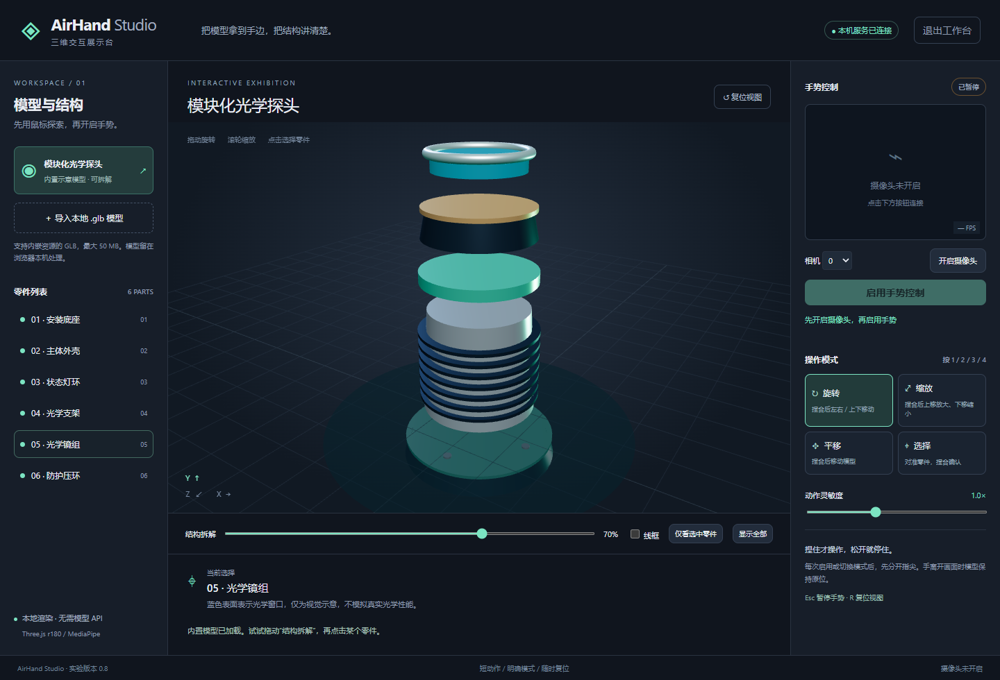

# AI Hand Project · AirHand Studio

基于普通摄像头的手势交互项目，包含 ROS 2 / Gazebo 机械臂仿真、三维模型展示工作台和 PowerPoint 演示助手。当前版本 v0.9.1，面向课程/毕设与交互原型验证。



## 功能

### 机械臂仿真

- Windows 手势识别桥接 WSL ROS 2，控制 Gazebo 三关节机械臂。
- 捏合离合与相对速度控制，支持 XY / XZ 平面切换；面板显示实际关节和末端位置。
- 独立会话、输入超时、松手/丢手/断连停止和工作区限制。
- 控制台内显示实际关节姿态、捏合原点和方向箭头；按住方向按钮也能操作。默认省去独立 3D 窗口，可按需打开 Gazebo GUI。
- 需要另行安装 Ubuntu 24.04 / ROS 2 Jazzy / Gazebo Harmonic；当前为解析 IK + 关节轨迹控制，MoveIt Servo 与夹爪抓取待接入。

### 三维工作台

- 拇指与食指捏合后小幅移动，控制旋转、缩放、平移；松开后停止操作。
- 内置六部件光学探头示意模型，支持结构拆解、选择、单独显示、线框与复位。
- 导入资源内嵌、未压缩的 glTF 2.0 GLB；最大 50 MB / 300 个网格。
- 鼠标与快捷键始终可用。切换模式后先松开；丢手、过期画面和异常跳变解除抓取。
- Three.js 依赖随项目提供，本机 Python 识别与浏览器 WebGL 渲染分离。

### PPT 助手

- 连接正在放映的 PowerPoint，拇指捏食指下一页、捏中指上一页；读取实际页码确认结果。
- 屏幕指示点、置顶悬浮控制条与可折叠小图标。
- 可选的当前页视觉摘要，支持智谱、Kimi、星图及兼容接口；发送前由用户手动触发。
- API Key 只保留在运行进程中，不写入配置文件。摘要会向所选服务发送该页图片，费用取决于服务账号。

## 环境与启动

已在 Windows x64 / Python 3.12 上验证。三维工作台推荐 Chrome 或 Edge，需支持 WebGL；PPT 功能需要 Microsoft PowerPoint。WPS 分支尚未完成实机覆盖。

```powershell
git clone https://github.com/x543819-sys/AI_Hand_Project.git
cd AI_Hand_Project
.\setup.bat
```

首次安装需要网络下载 Python 依赖与固定版本 MediaPipe Hand Landmarker。模型权重不提交到仓库，setup.bat 会自动下载并校验 SHA256；模型准备好后，三维工作台正常使用无需联网。

- 双击 `run_3d.bat`：打开三维工作台。先试鼠标，再开启摄像头并启用手势。
- 双击 `run.bat`：打开 PPT 助手。也可从顶部「3D 工作台」切换场景。
- 双击 `run_robot.bat`：启动机械臂工作台和 Gazebo 物理仿真；先按住方向按钮确认能动，再打开摄像头并启用手势。详见 [机械臂指南](ROBOT_ARM_GUIDE.md)。
- 三维操作：`1/2/3/4` 切换旋转/缩放/平移/选择，`Esc` 暂停手势，`R` 复位。
- 退出工作台可关闭相机与本机服务。避免两个程序同时占用摄像头。

手动下载模型：

```powershell
.\.venv\Scripts\python.exe main.py --download-model
```

安装版本记录见 requirements-lock.txt；setup.bat 使用 requirements.txt 的直接依赖。虚拟环境、个人配置、备份与会话记录均被 Git 忽略。

## 文档

- [机械臂仿真使用与限制](ROBOT_ARM_GUIDE.md)
- [机器人开源参考与演进方案](ROBOTICS_PLAN.md)

- [三维工作台使用与限制](VIEWER3D_GUIDE.md)
- [GitHub 参考、采用/舍弃的做法与版本](VIEWER3D_REFERENCES.md)
- [星图与自定义模型接口](XINGTU_API.md)
- [验证记录](TEST_REPORT.md)
- [后续方向](NEXT_STEPS.md)
- [第三方来源与许可证](THIRD_PARTY_NOTICES.md)
- [早期版本说明](docs/CHANGELOG_ARCHIVE.md)

## 验证

```powershell
.\.venv\Scripts\python.exe -m unittest discover -s tests -v
.\.venv\Scripts\python.exe tools/verify_ui.py
```

v0.8 的 91 项 Python 测试与原界面检查通过；v0.9 新增机器人意图、运动学与协议检查。机械臂联调使用 Windows 合成手势连接真实 Gazebo，验证实际移动与停止。浏览器验证覆盖真实 WebGL 渲染、GLB 导入、选择拆解、合成捏合旋转、丢手重入与暂停；合成输入不能替代真人手势体验。用户已试用三维基本控制，机械臂真人手感待试用。

三维端到端测试可选安装 Node.js 与 Playwright：

```powershell
npm install
npm run test:viewer3d
```

测试需要本机 Chrome；可通过 AIRHAND_BROWSER 指定 Chromium 可执行文件，通过 AIRHAND_TEST_PYTHON 指定 Python 路径。该测试使用专用合成相机，不打开真实摄像头。

## 当前边界

个性化手势采集与训练、双手缩放、复杂模型语义拆解尚未实现。导入模型按网格近似分离，暂不播放动画，也不支持 Draco/Meshopt/KTX2 压缩。内置模型为程序生成示意，不是工业 CAD。

本项目侧重交互工程与体验验证；已记录对开源项目的借鉴，不将现成识别模型或三维引擎宣称为原创算法。
